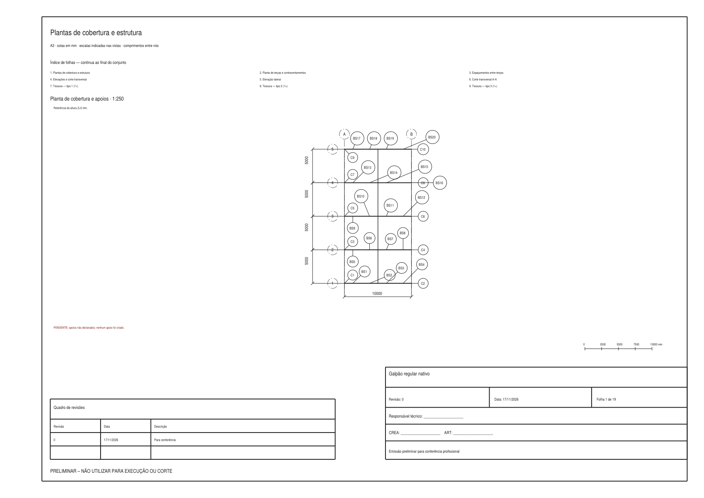
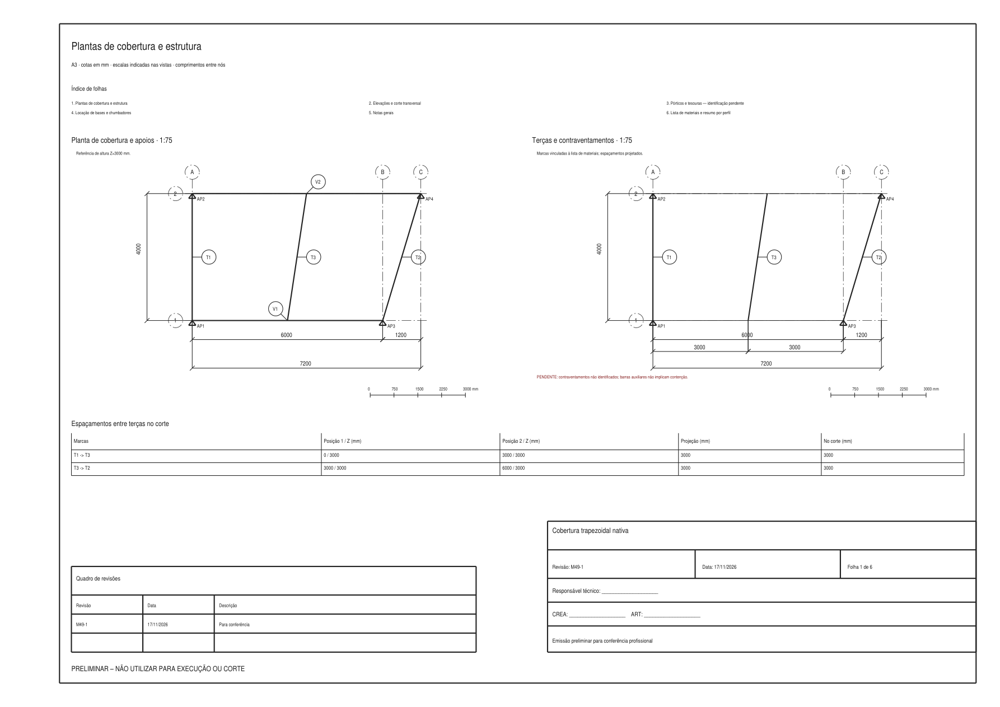

# Pacote completo de documentação — issue #140

Base: PR #139 (`bd7cede8807679aaf5c28858de72caeeac88157b`).

Em **Resultado → Arquivos → Exportar pacote completo**, selecionar A3/A1. O
download acontece no navegador, sem serviço Python, conversão externa ou scripts
do usuário. Cada arquivo também pode ser baixado individualmente. Alterar projeto,
formato ou estoque invalida os documentos exibidos anteriormente.

## Conteúdo e fonte dos dados

- `cad/pranchas.dxf`: o `createStructureDxf` existente, com suas pranchas nativas,
  escalas, viewports, cotas, tabela, carimbos e IDs. Também atende geometria gerada
  pelos parâmetros do projeto, sem convertê-la em declaração mecânica.
- `pranchas/pranchas.pdf`: mesma geometria de papel e mesma paginação. `CadBook`
  registra primitivas vetoriais enquanto gera o DXF. As vistas PDF deslocam essas
  mesmas coordenadas; cotas reutilizam os blocos gráficos das cotas nativas. As
  folhas grandes recebem plantas e espaçamentos separados; projeções coincidentes
  nas elevações gerais usam uma marca representativa, com peças completas nos
  detalhes e tabelas. Não há teto de folhas.
- `materiais/lista.csv`: IDs, perfil, material, quantidade, comprimento entre nós,
  massa linear, massa total e preço cadastrado. UTF-8 BOM, separador `;`, escape de
  aspas e proteção contra interpretação de texto como fórmula.
- `corte/plano.csv`: grupo, perfil/material, barra comercial, ID/comprimento de cada
  peça, serra, pontas, sobra, reaproveitamento e utilização. As colunas de perdas são
  **totais da barra**, repetidos nas linhas das peças; não somá-los por peça.
- `memorial/quantitativos.pdf`: identificação, revisão, parâmetros, totais, materiais,
  plano visual de corte, custos conhecidos do orçamento, premissas e pendências.
- `rastreabilidade/projeto.json`: snapshot completo utilizado na geração.
- `manifesto.json`: revisão, emissão, formato, dimensões/paginação, totais, estoque
  declarado, pendências e SHA-256/tamanho de cada documento. O hash do manifesto
  não é incluído nele próprio. Hashes são conferência de integridade, não assinatura
  digital nem comprovação de aprovação por um responsável técnico.

`packageTakeoff` usa `declaredTakeoff` para barras declaradas e as peças reais de
`generateStructure` para as geradas. Não utiliza quantitativos comerciais antigos
para reconstruir geometria. `packageCutting` reutiliza `projectCutting` no gerador
e `packBars` no modelo declarado. O agrupamento conserva identidade de material e
seção. Os ensaios comparam também o comprimento bruto transferido ao orçamento;
perdas comerciais e compras arredondadas são grandezas distintas.

O estoque de cada grupo declarado é uma entrada explícita nas opções da exportação,
registrada no manifesto; não altera os contratos de análise. O catálogo físico
precisa identificar o perfil. Serra, duas perdas de extremidade e limite de sobra
devem estar preenchidos (inclusive zero explícito). Comprimentos finais só são
usados se a opção do projeto estiver ativa e a assinatura de cada peça for atual.
FFD permanece heurística, sem prova de mínimo global. O arredondamento de consumo
para micrômetros é o mesmo do motor de corte existente.

## Pendências e limites

Sem dados para corte, não se produz um CSV aparentemente válido: o ZIP traz
`corte/PENDENTE.txt`, memorial e manifesto explicam a recusa. Falta de massa,
perfil, apoio, capacidade ou preço continua explícita. As pranchas geradas usam
perímetro do gerador geométrico; modelos declarados exigem suas próprias faces.

`computedStructuralApproval=false`, `fabricationRelease=false` e
`releaseGate=NOT_READY_BLOCKED` permanecem no manifesto. Todos os PDFs têm aviso
preliminar. Nenhuma ligação, chumbador, base ou capacidade é dimensionada pela
exportação. Reações só entram com o recibo existente de análise atual conferida;
o botão não inventa nem restaura resultados numéricos.

PDF usa Helvetica/WinAnsi e a largura relativa do texto CAD (.85). Símbolos
incompatíveis são transliterados; o DXF editável mantém seus estilos nativos.
Impressão física e abertura em AutoCAD comercial precisam de conferência posterior.
Os ZIPs usam STORE (sem compressão) e CRC32 para compatibilidade e implementação
local sem nova dependência de runtime. Arquivos grandes ocupam memória do navegador.

## Reprodução

```powershell
npx vitest run src/lib/exports
.tools/validation/Scripts/python.exe tests/verify_complete_package.py --render
npx playwright test tests/e2e/complete-package.spec.ts
npx tsc --noEmit
npx eslint .
```

O Python de auditoria requer `ezdxf` (já no lock de validação). A opção de prévia
`--render` requer também PyMuPDF/Pillow, só para QA; a aplicação não os utiliza.
Os artefatos locais ficam em `.tools/complete-package/{regular,irregular}`:
ZIP, todos os documentos, imagens de todas as páginas e mosaico de conferência.

O teste regular usa parâmetros nativos de um galpão de duas águas (123 peças);
o irregular aplica afunilamento paramétrico ao modelo nativo de cobertura M49,
sem desenho ou PDF externo. Ambos conservam coordenadas, IDs e comprimentos.
O verificador independente reabre ZIP/CSV, recalcula hashes, audita DXF sem
reparos e compara os cortes (considerando o arredondamento de micrômetros).
Playwright cobre o botão, download individual, mudança de formato e os comprimentos
comerciais explicitamente preenchidos na interface irregular.

## Evidência local desta entrega

- Vitest completo: **126 arquivos, 982 testes aprovados** (588,82 s).
- Exportação após o último ajuste de paginação: **7 arquivos, 34 testes aprovados**.
- Playwright do pacote: **2 testes aprovados**, projeto regular e irregular; ZIP e
  PDF individual baixados pelo navegador.
- Typecheck e build de produção aprovados. ESLint: zero erros; seis avisos
  preexistentes (incluindo arquivos gerados do workflow).
- Auditoria independente: **123 peças / 19 layouts A3** no galpão e **5 peças /
  6 layouts A3** na cobertura trapezoidal; ZIP/CRC, SHA256, CSV, coordenadas 3D e
  DXF sem erros/reparos aprovados. Com `--render`, também confere segmentos do PDF
  contra o DXF e as transformações dos viewports, além de renderizar todas as folhas.
- Next.js emite um alerta de segurança da versão instalada; dependências não foram
  alteradas nesta entrega. A atualização merece tarefa própria.

Exemplos produzidos automaticamente pelos testes (dados sintéticos):

- [Galpão — pacote ZIP](validation/complete-package/galpao-pacote.zip)
- [Galpão — pranchas PDF](validation/complete-package/galpao-pranchas.pdf)
- [Cobertura irregular — pacote ZIP](validation/complete-package/irregular-pacote.zip)
- [Cobertura irregular — pranchas PDF](validation/complete-package/irregular-pranchas.pdf)



