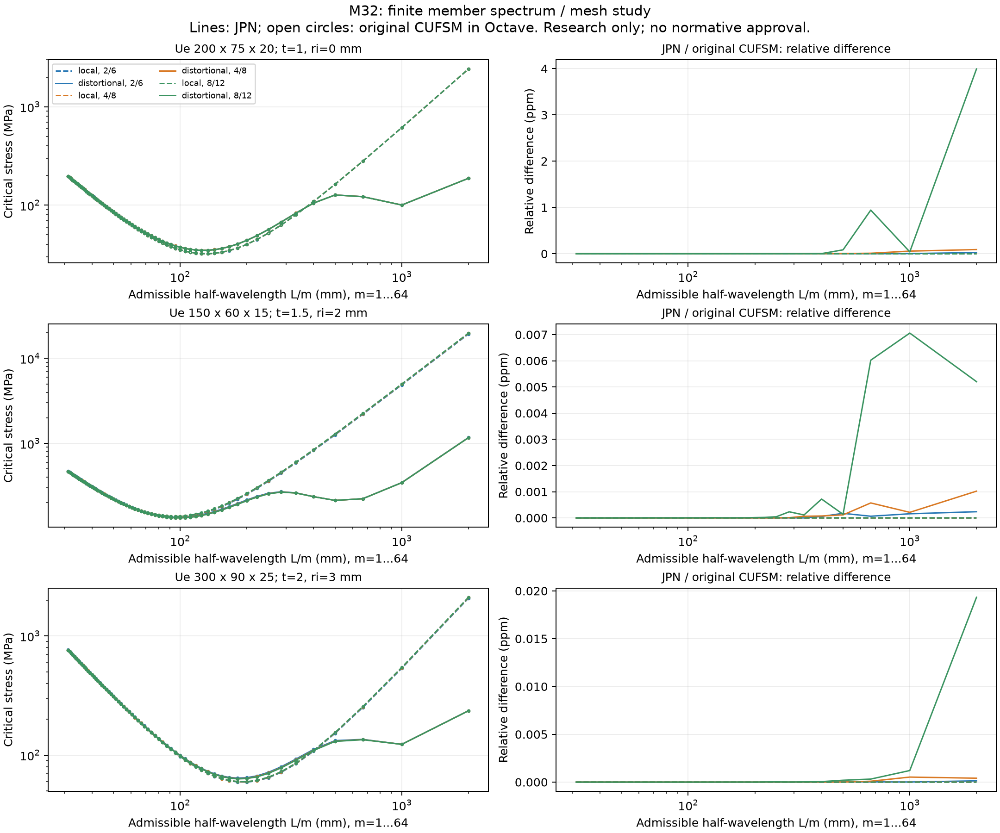

# Missão 32 — estabilização numérica e segunda ordem mista

Campanha de 04/11/2026. **Pesquisa executável e verificações no domínio declarado; sem aprovação estrutural, normativa ou de fabricação.**

## Base, isolamento e rastreabilidade

HEADs conferidos antes de modificar código:

| PR | Branch | SHA |
|---|---|---|
| #41, Missão 31 | `feat/m31-structural-audit` | `5b3f854908fc8d02ff22c064c900c96b1739b25c` |
| #42, pesquisa geométrica | `research/second-order-geometric-matrix-audit` | `45db57402a9b6c63ba6ea374825478a0b46a9f18` |
| #43, handoff e oito oráculos | `research/m32-claude-handoff-and-oracles` | `0d7ebc2729fb4f370a7d99fa7f6f4751d6f12696` |

Branch de implementação: `feat/m32-numerics-mixed-second-order`, derivada do HEAD do #43. O #42 foi consultado como pesquisa, sem merge. Foram lidos o handoff, os oito oráculos, o estudo de matrizes, o relatório M31 e os módulos efetivamente utilizados. A pasta antiga da loja e as branches concorrentes foram preservadas. Publicação automática desta branch desativada nos dois `vercel.json`; sem merge ou deploy.

SHA final dos algoritmos numéricos auditados: `810fdbfb21412f38f98c2676d4939b4a8703cf45`. Implementação inicial em `3850e2a855ae6ed65f404f4b917e2292dae40e0a`; primeira regressão completa em `6317bfe8d0499fc310c8e632558db9a196f36bf4`; publicação inicial em `96e3794a708555df62318220b37e8950ac9c70a2`. A CI dessa publicação encontrou instabilidade numérica no Linux, corrigida no SHA final acima. Os retestes e seus limites constam abaixo. O SHA de entrega, posterior de evidências, consta no [PR #44](https://github.com/brunoJuniorBrz/JPN/pull/44).

## Ambiente e referências executáveis

Windows 10, Python 3.12.16 e Node 24.22.0. Os três ambientes continuam separados: principal com `requirements-sections.lock`; legado FSM com `requirements-fsm.lock`; combinado com `requirements-sections-fsm.lock`. Neste último: NumPy 2.3.3, SciPy 1.15.3, pyCUFSM 0.2.0 e sectionproperties 3.10.2. BLAS/OMP/MKL usam uma thread. Lockfiles, primeira ordem, orçamento, geometria, CAD e interface são conferidos por preservação e regressão.

Referências externas realmente executadas:

- CUFSM MATLAB original, commit `ab449cef8d05bb489df591d2e5b4e74571a793f5`, por GNU Octave 11.3.0 portátil. O driver chama as funções originais de montagem, base e seleção modal; não recebe matrizes ou bases Python. Usa Cholesky e autoproblema simétrico ordinário como caminho numérico distinto do `eigh` generalizado Python.
- Stabileo, commit `58fc63cef585918c5025acc71488f73f5fbf4afc`, CLI `solve_json` compilada com Rust 1.99.1, alvo Windows GNU. Bibliotecas resolvidas pelo Cargo.lock original. Nenhum código do solver foi alterado ou incorporado ao produto.
- Frame3DD, commit `73a022adf1ba9d168640254bf22557e21dfb5fc4`, compilado com GCC 15.2.0. HPGnumlib em `2861fe6a3764661dd020784f6d79577e08afdb9e`. Uma função POSIX de alteração de dono/permissão, não utilizada pelo Frame3DD, foi desativada para compilar em Windows. Matrizes, solver e cálculos de saída não foram modificados. O script de compilação e hashes da adaptação estão publicados.

Binários externos e arquivos de instalação não são redistribuídos. Inputs, outputs e hashes dos executáveis estão nas evidências. Usar os drivers com fontes fixadas permite reconstruir os ensaios.

## A — falha e correção do resíduo reduzido

O critério M31 dividia o resíduo dos graus livres pela norma de ações de todos os graus. Cargas diretamente nos apoios contaminavam a normalização. O contraexemplo do #43 permanece exatamente: resíduo livre 1 N, carga restringida `1e12 N`, razão antiga `1e-12`, razão reduzida `1`; limite `1e-8`.

O novo teste alcança `analyze_frame_pdelta`, executa primeiro o PyNite real e injeta depois um erro de `1e-9 m` no deslocamento livre retornado. Com carga diretamente no apoio de `1e9 N`, dentro do contrato, o código antigo não recusava esse resultado. Sem essa carga, recusava. É uma **falha comprovada do gate**, não afirmação de que o PyNite produziu naturalmente tal erro. O JUnit anterior registra a ausência da recusa e a dependência indevida do indicador em relação à carga restringida.

Agora, para o conjunto livre `f` e escala física `L`:

`r_f = (K u - P)_f`

`S = diag(1,1,1,L,L,L, …)`

`rho = ||S_f^-1 r_f|| / max(||S_f^-1 (K u)_f||, ||S_f^-1 P_f||, 1e-30)`.

Forças e momentos são comparados em unidades equivalentes de força. Numerador e denominador usam os mesmos índices. O limite `1e-8` e o piso preexistente foram preservados. O resultado inclui norma absoluta escalonada, denominador, quantidade de graus e comprimento usado; não se introduziu uma tolerância absoluta para aceitar resíduos ruins. O caso sem graus livres tem resíduo reduzido zero; valores não finitos são recusados.

O resíduo com esforço axial atualizado também usa essa métrica. Continua separado do resíduo do sistema de tensão inicial realmente resolvido. A versão do normalizador é `jpn.reduced-equilibrium/2`. Controles de escala 0,001–1.000 m, forças/momentos, carga restringida e o subprocesso real complementam os testes de balanço, biapoiado, eixos, tração/compressão e reações da M31.

## B — auditoria externa do cFSM e correções adicionais

A estabilização do autoproblema da M31 era necessária, mas não verificava a correção física dos espaços fornecidos pela biblioteca. A comparação externa encontrou defeitos adicionais no porte Python:

1. `base_vectors` procurava um elemento adjacente usando `np.any(...) or np.any(...)`. Isso selecionava o elemento zero e dava a diversos nós uma normal da parede errada.
2. `y_dofs` confundia o índice zero com o marcador de nó ainda não visitado e usava o valor de empenamento onde deveria consultar o marcador. A reconstrução em `cutwp.prop2` também retornava empenamentos normalizados nulos por outros erros de índice/array. Esses valores não sustentam a classificação modal.
3. `constr_xz_y` verificava o número do segundo elemento onde deveria consultar o sentido de incidência. O vínculo de canto `Rx` divergia do original.
4. `analysis_c.trans` recebia o ângulo como `float` C, reduzindo a precisão da rotação mesmo com arrays double.

No primeiro caso externo, Ue 200×75×20×1 mm, malha 2/6, comprimento de onda `870,2079655673336 mm`, o avaliador anterior dava aproximadamente **148,169754 MPa** para o modo distorcional; CUFSM/Octave dava **104,380958 MPa**. A divergência relativa era **41,95%**, com espaços distintos. Os resíduos pequenos da M31 não invalidam esse achado: um problema projetado errado pode ser resolvido numericamente com grande precisão. A evidência anterior está em `initial/cufsm-before.json`.

As correções em `modal_kinematics.py` são limitadas ao domínio Ue aberto:

- Modos locais: rotações nos nós e deslocamentos normais à **parede adjacente real** em nós de borda/subdivisão. Nenhuma dimensão modal é descartada.
- Vínculos de canto: resolver as duas equações de inextensibilidade das paredes incidentes, com direções e comprimentos físicos, em vez de reutilizar a incidência defeituosa.
- Modos longitudinais globais: espaço completo `span(1,x,z,omega)`, integrando `omega_j-omega_i = x_i z_j-x_j z_i` no grafo aberto. Mudança da origem de empenamento ou dos eixos altera a base por combinações de `1,x,z`, preservando o espaço.
- Espaço distorcional: complemento ponderado por `Ryd` do espaço global, intersectado com as restrições longitudinais admissíveis do CUFSM. Dimensão incompatível é erro; nenhum modo físico é removido por conveniência.
- Matrizes: kernels **reais** do pyCUFSM 0.2.0, chamados em coordenadas locais de uma faixa de dois nós, com ângulo zero exato. A rotação para os eixos globais usa `analysis_p.trans` em double. Assim se conserva a equação original do elemento e se evita o estreitamento do ângulo no caminho Cython global. A montagem é conferida também contra o caminho Python completo em seis casos.

A SVD, solução inversa em métrica elástica, resíduo `1e-8`, condicionamento `1e10`, conferência de energia e limite de acumulação da M31 continuam. O teste variacional passou a usar um vetor realmente admissível no espaço corrigido: um autovetor da biblioteca antiga, pertencente a outro espaço, não é automaticamente um limite superior válido.

A busca contínua reproduziu uma falha adicional do resíduo projetado em `1999,9999999999998 mm`, após converter `exp(log(2000))`. A simetria de energia agora é reaplicada depois do escalonamento diagonal, que pode introduzir assimetrias de uma ulp. Quando o par ainda excede `1e-8`, permitem-se até três correções Newton do **mesmo autoproblema**, mantendo somente um par melhor. O sistema aumentado usa `Gs-mu Ks` como Jacobiano/precondicionador, mas seu vetor de normalização e resíduo são formados a partir de `K p` e `G p` originais, com `p=v/scale`; depois se repetem as verificações originais de resíduo, energia, positividade e condicionamento. Se não cumprir os critérios, continua recusado. Isso refina um autovetor/autovalor e não representa iteração geométrica da estrutura. Dois oráculos diagonais independentes, um caso de direção elástica suave com arredondamento simétrico controlado e o ponto de arredondamento cobrem essa correção. O novo caso tem condição aproximada 2e8; um primeiro ensaio com condição 2e9 encontrou o piso de cancelamento do matvec double e foi preservado como tentativa de desenvolvimento, sem alegação de solução universal. A campanha externa final teve no máximo uma correção por par.

### Campanha cruzada

[Dados brutos](validation/mission32/cufsm-campaign.json), [resumo e curvas discretas](validation/mission32/cufsm-summary.json), driver MATLAB e driver Python em `validation/mission32/`.

| Item | Resultado |
|---|---|
| Geometrias sintéticas Ue (mm) | 200×75×20, t=1, ri=0; 150×60×15, t=1,5, ri=2; 300×90×25, t=2, ri=3 |
| Malhas por geometria | Arco/plano 2/6, 4/8, 8/12 |
| Comprimentos | `2.000/m mm`, m=1…64, mais dois valores quase iguais em torno do caso sensível |
| Comparações executadas | 594 casos, 1.188 autovalores/modos; zero falhas nos critérios fixados |
| Maior diferença relativa entre autovalores | `3,99480e-6` |
| Maior diferença de projeção entre espaços | `4,98799e-10` |
| Maior resíduo projetado JPN | `8,53254e-9` |
| Maior condição elástica escalonada | `3,93697e7` |
| Fixtures de regressão do executável externo | 36 casos, com valores e modos originais |

Critérios da auditoria definidos antes da campanha: matrizes `1e-12` relativo, projeção de espaços `1e-6`, autovalores `1e-5`. Não foram aumentados após ver os resultados. Correlação vetorial é diagnóstico; sinal arbitrário e autovalores repetidos exigem comparar espaços, não apenas componentes de um vetor.

**Concordância entre executáveis não é convergência de malha.** A primeira geometria atende ao alvo `0,001` nos mínimos governantes; as outras duas apresentam mudanças de aproximadamente 0,003–0,005 entre as malhas finais e permanecem fora da admissão ao MRD. O maior limite de acumulação, em ponto não governante, chegou a `0,04296`; isso não é certificado de erro e não autoriza resistência. Nos mínimos governantes das três geometrias, os limites observados ficaram abaixo de `0,001`. Os gates de malha e energia continuam separados.

As 64 semiondas inteiras permanecem o domínio admitido para o membro finito. O diagnóstico contínuo não substitui esses modos. A cauda `m>64` continua sem certificação.

### Invalidação dos resultados anteriores

A correção física exigiu novo avaliador **`jpn.nbr14762-mrd/4`**, com `kinematics_version=jpn.cfsm-kinematics/2` e backend registrado. Os `/2` e `/3` permanecem legíveis como histórico, mas não podem compor uma execução automática atual sem recálculo. Assim, o requisito mínimo de não reutilizar `/2` foi estendido aos resultados da M31 afetados por esta descoberta. O contrato resistente não ganhou aprovação integral nem novos coeficientes ABNT.

### Desempenho sem reduzir o domínio

A primeira regressão teve um timeout de worker de 20 s. A falha foi preservada e o prazo não mudou. No domínio S-S/m=1, o bloco retido de rigidez transversal usado na condensação é proporcional ao comprimento de onda: `I1=L/2`, `I2… I5=0`, com graus longitudinais excluídos. Logo `Rp=-Kpp^-1 Kpc` é independente de L e pode ser calculado uma vez por malha. Seis testes conferem essa identidade no kernel real.

Também se conserva a SVD do espaço local, que depende apenas da seção, e se constroem diretamente todas as colunas distorcionais selecionadas, evitando reconstruir espaços globais/outros que nunca eram selecionados. Não se retiraram semiondas ou modos locais/distorcionais. Depois dessas mudanças, os dois workers de referência levaram aproximadamente 15,0 e 14,8 s no ensaio focado. A comparação externa final de 594 casos foi repetida com a implementação otimizada, usando as matrizes/bases nativas já calculadas e os mesmos critérios.

## C — protótipo misto isolado de tensão inicial

Novo contrato `jpn.mixed-initial-stress/1`, com declaração explícita `hermite-bending-and-axial-projector`. Exemplos sintéticos executáveis em `engine/examples/mixed-initial-stress-*.json`. A integração é exclusivamente CLI/worker, sem habilitar HTTP, interface ou dimensionamento normativo.

Procedimento por combinação, sem superposição posterior:

1. Validar o modelo físico e executar a primeira ordem existente. Conservar esse resultado, seus hashes e procedência.
2. Obter `N0` por elemento e combinação. Tração é positiva; compressão, negativa.
3. Montar a rigidez elástica dos mesmos elementos e a contribuição geométrica de tensão inicial. Comparar a montagem elástica com a biblioteca nativa.
4. Resolver uma vez `(Ke+Kg(N0)) u1=P`, com os mesmos graus livres e vínculos. Conferir simetria, positividade, condicionamento, finitude, resíduo reduzido e limites de movimento.
5. Recuperar ações de extremidade com as mesmas matrizes fixadas realmente resolvidas. Somar ações nos nós e verificar a identidade global correspondente.

Para a barra exclusivamente axial:

`G = I - e eᵀ`

`Kg = (N0/L) [[G,-G],[-G,G]]`.

São seis translações, sem flexão ou torção fictícia. O resultado retém as forças transversais geométricas de extremidade; isso não as transforma em momentos fletores de uma barra axial. Rotações inexistentes de nós apenas axiais são eliminadas matematicamente, sem inventar engastes.

Para pórticos, utiliza-se a energia de flexão Euler–Bernoulli:

`Ug = N0/2 integral_0^L (v'²+w'²) dx`.

O bloco Hermite plano é `N0/(30L)` multiplicado por:

```text
 36    3L    -36    3L
 3L   4L²    -3L   -L²
-36   -3L     36   -3L
 3L   -L²    -3L   4L²
```

O segundo plano trata corretamente o sinal de `theta_y`. A transformação local/global usa as bases nativas auditadas. **Este protótipo não inclui rigidez geométrica longitudinal ou torsional**, empenamento, excentricidades ou liberações. Isso é declarado pelo contrato, não uma equivalência presumida com toda a matriz `kg` do PyNite. A rotina M31 continua com seu método nativo e suas soluções corretas.

O equilíbrio de momentos do modelo de tensão inicial usa a identidade `sum(Mexterno + x × Fexterno) + sum(delta_u_elemento × N0 e)=0`. O resíduo de momentos na geometria totalmente deformada também é exportado, sem ser declarado convergido. Ações nodais recuperadas, energia elástica/geométrica, condição da tangente e estimativa proporcional de instabilidade são rastreadas por combinação.

**Não há iteração geométrica não linear completa.** O resultado tem `status=CONDITIONAL`, `release_gate=BLOCKED`, `nonlinear_iteration_convergence_verified=false`, `mesh_convergence_verified=false`, `normative_second_order_verified=false` e `approved_for_fabrication=false`.

## Comparações de segunda ordem e limites físicos

### Barra-coluna da M31

Mesmo modelo discretizado em 16 elementos, L=4 m, E=200 GPa, I=1e-5 m⁴, H=100 N, compressão de 60% da carga de Euler. Cargas e eixos equivalentes; sem cisalhamento, torção, rótulas ou empenamento.

| Solução executada | Deslocamento lateral (m) |
|---|---:|
| Analítica contínua | 0,002644497144467381 |
| JPN/PyNite nativo, M31 preservado | 0,002644496838676522 |
| Stabileo real | 0,0026444968386772415 |
| Frame3DD real | 0,002644497 |

Frame3DD foi alimentado em N/mm e a saída convertida para m; seu arredondamento impresso não foi confundido com erro de solver. Stabileo usa MPa/m/kN, com conversões explícitas. As expressões analíticas de compressão, tração e biapoiada permanecem testadas. [Inputs e outputs](validation/mission32/external-frame/summary.json).

### Estrutura mista com solução fechada

Balanço elástico com barra axial transversal bilateral. A força inicial da barra é independente da resposta lateral nesse subcaso. Após condensar a rotação do balanço, `k=3EI/L³=750.000 N/m`; a rigidez lateral é `k + N0/Laxial`. Logo `uy=H/[k(1-r)]` para a parametrização de compressão adotada. Isso valida o acoplamento real dos elementos, além do surrogate matemático do handoff.

Foram executados JPN e Stabileo nos cinco casos r=0; 0,2; 0,8; 0,95 e -0,6, com todos os subcasos convergidos no Stabileo. A maior diferença relativa lateral foi `1,96783e-14`. Casos em/acima da singularidade são recusados no JPN. As áreas axiais são reais entradas sintéticas; o modelo externo usa `truss` com Iy/Iz/J nulos, sem pórtico de rigidez diminuta. [Evidência](validation/mission32/external-mixed/summary.json).

### Pórtico contraventado espacial

Exemplo com colunas e viga explicitamente discretizadas, contraventamento fora do plano, apoios físicos, cargas verticais e laterais. A campanha do módulo real verifica frações 0,2; 0,8; 0,95 e 1,01 da estimativa de instabilidade proporcional: estados estáveis equilibram; acima do limite, recusa. Rotação espacial, translação de origem, inversão dos nós, sinal, energia e combinações distintas também são exercitados.

O mesmo pórtico foi enviado ao Stabileo. A maior diferença de translação observada foi cerca de `1,006e-9 m`, mas **não se reivindica equivalência física completa**: o externo atualiza esforços e contém energia torsional geométrica, enquanto o protótipo fixa N0 e usa apenas flexão geométrica. O relatório desse caso é diagnóstico, não benchmark aprovado. Frame3DD não foi usado para simular o misto por uma aproximação flexional fictícia de treliça.

## Workers, regressões e falhas preservadas

Limites: 100 nós e 128 elementos no protótipo; entrada 500.000 bytes; saída 2.000.000 bytes; 768 MiB de memória do processo; prazo de cálculo 20 s e encerramento da árvore Windows no lançador. JSON duplicado/não finito é recusado no worker existente. A CLI pública foi ensaiada com o worker real. Liberações, mecanismos, instabilidade, contraste irresolúvel, dados não finitos ou grandes movimentos produzem erro, sem fallback de aprovação linear.

Evidências de falhas e ajustes:

- Dois testes de resíduo falharam antes da correção; um deles demonstra que o resultado corrompido passava indevidamente.
- A primeira comparação externa cFSM falhou em espaços, autovalores e matrizes. As causas foram identificadas no código e corrigidas, com novos oráculos físicos e fixtures do executável independente.
- A regressão inicial do worker cFSM corrigido excedeu 20 s em um caso. Foram otimizadas a transformação e as construções invariantes da seção, sem relaxar prazo, malha, modos ou critérios; os testes de equivalência matemática e o perfil completo foram repetidos.
- O diagnóstico contínuo também falhou inicialmente no ponto `exp(log(2000))`, com resíduo acima do limite. A falha foi preservada. Simetrização após escala e refinamento limitado do autoproblema corrigiram o caso sem alterar `1e-8`; a busca e os 594 casos externos foram repetidos.
- Compilação externa: ausência inicial de headers POSIX no HPGnumlib e configuração do linker Windows GNU foram tratadas como problemas de ambiente. Não se alterou a matemática dos executáveis para obter concordância.
- O primeiro parser do Frame3DD leu o bloco linear que precede o resultado não linear. A discrepância correspondente foi preservada; o parser passou a selecionar explicitamente o bloco final. Também se consolidam ações repetidas em cada nó antes de escrever o arquivo externo.
- A campanha Octave foi interrompida por excesso de avisos repetidos de compatibilidade sintática MATLAB. Foram reaproveitados 192 resultados nativos concluídos, conferindo entradas idênticas, e calculados os 402 restantes. A comparação Python final percorreu todos os 594. Só o aviso identificado de curto-circuito sintático foi desativado; avisos numéricos continuam ativos.
- Na última suíte de propriedades, o worker do caso Ue 100×50×15×2 mm, raio interno 3 mm, excedeu 20 s; o reteste isolado também excedeu. Os outros sete testes da suíte passaram. A rotina de propriedades não foi alterada e as duas rodadas anteriores da campanha haviam registrado saída zero para o perfil. Isso constitui uma pendência operacional, não uma aprovação local integral. O prazo de 20 s foi mantido. Na comparação sequencial posterior, tanto o commit de partida limpo quanto a branch atual passaram, no mesmo ambiente, em 46,82 s e 46,55 s de teste total, respectivamente (inclui preparo das propriedades antes do worker). Isso demonstra intermitência, sem provar causa exclusivamente ambiental. As falhas continuam preservadas e `all_steps_passed=false`. Ver `baseline/checks.json`, `sections-paired-current.xml` e `checks.json`.
- As descrições de procedência dos dois exemplos mistos foram atualizadas para identificar corretamente suas cargas sintéticas, sem alterar valores, nós ou apoios. O perfil misto foi repetido depois dessa correção de metadados; essa repetição não é somada como novos testes.

A campanha completa de regressão, suas falhas eventualmente encontradas, correções e contagens finais são registradas no fechamento, com comandos/saídas em `docs/validation/mission32/`. Resultados M31 são histórico, não aprovação automática desta missão.

### Falha Linux identificada depois da primeira publicação

A CI do SHA `96e3794` executou realmente os testes e encontrou quatro recusas cFSM no Linux (52 aprovados), todas por resíduo projetado acima de `1e-8`; não foi falha de inicialização de runner. O refinamento anterior usava o resíduo do pencil escalonado/simetrizado. Isso podia melhorar esse problema arredondado sem melhorar suficientemente o resíduo das matrizes projetadas originais.

O commit `810fdbf` mantém o Jacobiano escalonado, mas corrige o resíduo e a normalização calculados das matrizes originais. Tolerâncias e número máximo de correções não mudaram. Os 594 casos externos foram reavaliados contra os mesmos resultados originais, com entradas idênticas; zero falhas e máximo de uma correção. As 36 fixtures mantêm valores/modos externos; apenas o hash do JSON bruto mudou. O núcleo foi repetido: 1.631 testes e 1.000 comparações aprovados. Os 56 testes cFSM, os diagnósticos contínuos, os workers automáticos e os 389 Vitest também foram repetidos. Os oito jobs numéricos da CI desse código passaram, cobrindo núcleo e os três perfis em Linux/Windows; o estado da aplicação e do HEAD final é registrado no PR e no snapshot correspondente.

Ver [falha remota original](validation/mission32/initial/ci-linux-residual-failure.log), [log Linux após correção](validation/mission32/ci-linux-cfsm-original-pencil.log), [retestes locais](validation/mission32/post-ci-checks.json) e [snapshot da CI do código](validation/mission32/ci-original-pencil.json).

## Reprodução

Preparar os ambientes pelos lockfiles preexistentes, sem instalar o pacote principal no perfil FSM opcional. Com os executáveis do computador atual, configurar `JPN_PYTHON_EXECUTABLE`, `JPN_SECTION_FSM_PYTHON_EXECUTABLE` e BLAS/OMP/MKL em uma thread. A lista exata de comandos e versões está em `checks.json` e `environment.json`.

```text
python -m unittest discover -s validation/mission32-handoff -p "test_*.py" -v
python engine/validate.py
python -m pytest engine/section_tests/test_member_buckling.py engine/section_tests/test_modal_numerics.py engine/section_tests/test_modal_kinematics.py -q
python engine/check_frame_pdelta.py engine/examples/frame-pdelta-cantilever.json --output frame.json
python engine/check_mixed_initial_stress.py engine/examples/mixed-initial-stress-portal.json --output mixed.json
```

Usar o Python do perfil combinado somente para testes cFSM e seus drivers. Para reconstruir a campanha externa, fazer checkout do SHA CUFSM fixado e executar `validation/mission32/audit_cufsm.py --cufsm-source ... --octave ... --work-dir ... --output ...`; o driver confere o SHA e as versões. `summarize_cufsm.py` deriva as fixtures e o resumo a partir do JSON bruto. Os drivers `build_frame3dd.py`, `compare_frame_engines.py` e `compare_mixed_stabileo.py` registram a compilação/adaptação e os ensaios reais dos binários externos.

## Matriz de limitações e liberação

| Procedimento | Estado | Condição de utilização/liberação |
|---|---|---|
| Resíduo reduzido dimensional e gate adversarial | IMPLEMENTADO E VALIDADO NO DOMÍNIO | Mesmo conjunto livre e escala em numerador/denominador; mantém 1e-8 |
| Matrizes/espaços cFSM corrigidos | IMPLEMENTADO E VALIDADO NO DOMÍNIO | 3 Ue, 3 malhas, compressão uniforme S-S; sem extensão universal |
| Resistência automática `/4` | CONDICIONAL | Exige propriedades, malha, energia, modelos e todos os gates existentes; não aprova a peça inteira |
| Geometrias adicionais sem convergência de malha | BLOQUEADO PARA MRD | Refinamento final precisa cumprir 0,001 sem alterar o critério |
| Worker do caso de propriedades com timeout | PENDÊNCIA OPERACIONAL | Cumprir 20 s no ambiente de execução; não aceitar resultado incompleto ou elevar o prazo para obter aprovação |
| Cauda espectral além de m=64 | NÃO VERIFICADA | Necessária demonstração de cobertura antes de ampliar o domínio |
| P-Delta nativo da barra-coluna M31 | IMPLEMENTADO EXPERIMENTALMENTE | Domínio anterior e convergência da malha do caso |
| Kernel axial e flexão Hermite mistos | IMPLEMENTADO EXPERIMENTALMENTE | Energia, sinais, transformações, estabilidade e casos equivalentes comprovados |
| Protótipo de pórtico misto geral | CONDICIONAL / LIBERAÇÃO BLOQUEADA | CLI de pesquisa; exige modelos externos equivalentes, convergência e domínio geométrico ampliado |
| Não linearidade geométrica completa | NÃO IMPLEMENTADO | Iterações, atualização de forças, teoria e equilíbrio próprios demonstrados |
| Torção geométrica, empenamento e liberações | BLOQUEADO | Formulação e condensação verificadas separadamente |
| Vento e combinações normativos completos | PENDENTE | Missão seguinte, normas/edições/corrigendas e ações verificadas |
| Compra, corte, fabricação, ART e aprovação estrutural | BLOQUEADO | Revisão e responsabilidade profissional; esta entrega não concede autorização |

## Fontes primárias

- [CUFSM original e licença MIT](https://github.com/thinwalled/cufsm-git/tree/ab449cef8d05bb489df591d2e5b4e74571a793f5), em especial `analysis/cFSM/yDOFs.m`, `base_vectors.m`, `constr_xz_y.m`, `klocal.m`, `kglocal.m` e `assemble.m`.
- [pyCUFSM](https://github.com/brookshsmith/pyCUFSM), confrontado com os arquivos realmente instalados do pacote 0.2.0; biblioteca AFL-3.0 preservada.
- [GNU Octave, distribuição oficial](https://octave.org/download).
- [Stabileo fixado](https://github.com/lambdaclass/stabileo/tree/58fc63cef585918c5025acc71488f73f5fbf4afc), `engine/src/solver/geometric_stiffness.rs`, `pdelta.rs`, tipos e CLI; AGPL-3.0, execução externa.
- [Frame3DD fixado](https://github.com/hpgavin/frame3dd/tree/73a022adf1ba9d168640254bf22557e21dfb5fc4), matrizes, recuperação e formato da saída; GPL, execução externa.
- [HPGnumlib fixado](https://github.com/hpgavin/HPGnumlib/tree/2861fe6a3764661dd020784f6d79577e08afdb9e).
- [PyNite 3.2.1](https://github.com/JWock82/Pynite/tree/3.2.1), `Member3D.kg`, `FEModel3D.Kg` e `Spring3D`; biblioteca real mantida no solver elástico.
- [Pesquisa #42](https://github.com/brunoJuniorBrz/JPN/blob/45db57402a9b6c63ba6ea374825478a0b46a9f18/docs/ESTUDO-RIGIDEZ-GEOMETRICA-SEGUNDA-ORDEM-MISTA.md) e [handoff #43](https://github.com/brunoJuniorBrz/JPN/blob/0d7ebc2729fb4f370a7d99fa7f6f4751d6f12696/docs/MISSAO-32-HANDOFF-CLAUDE.md), sem merge do estudo de outra base.

## Fechamento

A primeira regressão completa e os 73 Playwright locais foram executados em `6317bfe8d0499fc310c8e632558db9a196f36bf4`. Depois da falha Linux, núcleo, campanha externa, perfil cFSM, diagnósticos, workers e Vitest foram repetidos em `810fdbfb21412f38f98c2676d4939b4a8703cf45`, preservando os resultados e falhas anteriores. A alteração posterior de evidências não muda os algoritmos; o SHA final e a CI remota constam no PR #44 em rascunho, com base no #43.

| Verificação executada | Resultado |
|---|---|
| Oito oráculos do handoff | 8 aprovados |
| Núcleo Python | 1.631 aprovados; zero falhas, erros ou skips |
| Campanha independente do núcleo | 1.000 comparações aprovadas |
| Propriedades de seção, última suíte local completa | 7 aprovados, 1 timeout; reteste isolado também falhou; perfil passou depois na CI Linux/Windows |
| Controle sequencial do caso com timeout | Base limpa e branch atual passaram; causa da intermitência não resolvida |
| Perfil FSM legado / cFSM combinado | 4 / 56 aprovados, sem skips |
| Protótipo misto | 38 aprovados, já incluídos nos 1.631; repetição após ajuste de descrições também passou |
| CUFSM original/Octave | 594 casos, 1.188 autopares; zero falhas nos critérios da comparação |
| TypeScript / ESLint | Aprovados |
| Vitest | 389 aprovados, 47 arquivos; zero pendentes |
| Playwright | 73 aprovados; zero falhas, skips ou flaky |
| CAD/DXF | 2 testes CAD aprovados; ezdxf: 130 linhas 3D em mm, zero erros de auditoria |
| Build de produção | Aprovado |
| Preservação | 79 arquivos de fontes/lockfiles iguais à base, normalizando apenas CRLF de checkout |

O resultado global **não é totalmente aprovado**, em razão do timeout preservado. As comparações matemáticas, execuções independentes e regressões aprovadas não concedem verificação normativa ABNT. O protótipo misto continua `CONDITIONAL`, com liberação `BLOCKED`, `normative_second_order_verified=false` e `approved_for_fabrication=false`. Duas geometrias da campanha cFSM permanecem sem admissão ao MRD por falta de convergência de malha. Sem merge, deploy ou liberação de compra/corte/fabricação.

Evidências de fechamento: [resumo estruturado](validation/mission32/summary.json), [comandos e resultados](validation/mission32/checks.json), [ambiente e hashes](validation/mission32/environment.json), [campanha CUFSM bruta](validation/mission32/cufsm-campaign.json), [manifesto dos arquivos MAT originais](validation/mission32/original-cufsm/manifest.json) e [preservação](validation/mission32/preservation.json). Os arquivos MAT de duas malhas contêm matrizes, bases e modos realmente produzidos pelo original, para inspeção independente dos arrays Python; são probes diagnósticos fora da grade inteira, sem uso silencioso no MRD.



[Figura vetorial para exportação](validation/mission32/cufsm-comparison.svg), regenerada pelo driver público `validation/mission32/plot_cufsm.py` a partir do JSON bruto. A figura mostra as 64 semiondas inteiras por malha; concordância externa e convergência de malha são critérios distintos.
